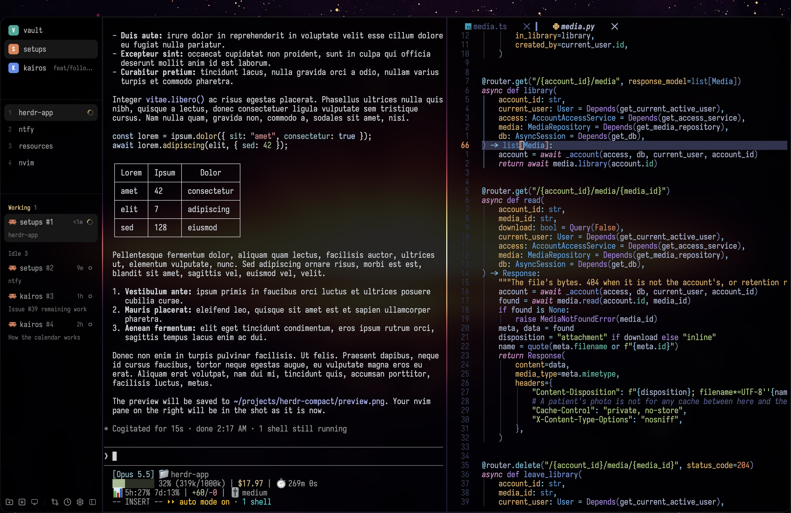

# Compact

A compact, see-through layout for [Herdr](https://herdr.dev). No title bar, no tab bar and no pane headers: one slim sidebar holds your spaces, the current space's tabs and your agents, with a single row of icons at the bottom. Everything else is terminal, and the desktop shows through softly blurred.



## What's in it

- **Spaces, Tabs, Agents** stacked in the sidebar, with no headings.
- **Numbers that match the shortcuts:** tabs show 1–9 for Cmd+1–9, and agents show `#1`–`#9` for Ctrl+1–9.
- **Two-line agent rows:** name, time and status on top, the agent's description below.
- **One icon row** at the bottom: new space, new tab, add machine, then Changes, sort agents, settings and collapse.
- **See-through glass:** blurred desktop behind the terminals and the sidebar, with faint dividers and solid black popups.

## Install

Copy the layout and its mods into your Herdr folder, then switch to it:

```sh
cp layouts/compact.json ~/.config/herdr-app/layouts/
cp -R mods/compact-* ~/.config/herdr-app/mods/
herdr-app do layout.switch '{"name":"compact"}'
```

`ctrl-shift-l` switches back to your previous layout.

## More

`RECIPE.md` describes the layout in full: what each part looks like, how it behaves, how it's built and what to watch out for.
