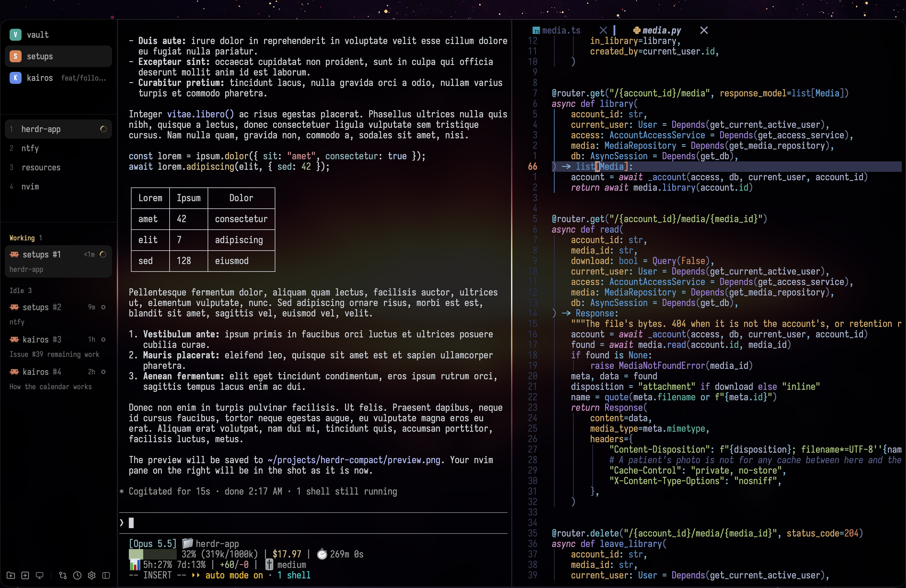

# Compact

A compact, see-through Herdr window with no title bar and no tab bar. One narrow sidebar holds three stacked lists (spaces, the current space's tabs, agents) and a single row of icons at the bottom; everything else is terminal. The desktop shows through the window, softly blurred, so a dark wallpaper reads as faint light behind the text.

## What you see

Left to right:

- **Sidebar**, 268px wide (resizable 44–480px), background `chrome` `#00000074` (black at 45%, painted twice by the column and each list, so about 9% of the desktop shows through). No headings anywhere. Three lists stacked top to bottom, sharing the height equally (weight 1 each, user-resizable), separated by 1px lines in `border` `#ffffff14`:
  - **Spaces**: one 36px row per space. A 20px rounded square in the space's colour with its first letter in white (11.5px bold), the name at 14.5px in `foreground`, and the git branch after it at 12.5px in `dim`, cut off with "…". The active space has an 8px-rounded `selected` background (`#ffffff17`, white at 9%).
  - **Tabs**: the active space's tabs, one 32px row each. A faint number 1–9 first (12.5px, `dim` at 70% opacity, the same in every row), then the tab name at 14.5px (`foreground` when active, `muted` otherwise). A working tab shows a spinning 12px spinner on the right; a blocked or done tab shows a 6px dot in that status colour. The active tab has the `selected` background.
  - **Agents**: two-line rows, 54px with a description, 36px without. Line one: the agent's 16px program icon, its name at 14.5px followed by `#N` (N = 1–9, its Ctrl+N number, `dim`), then on the right the time since its last change (12px, `dim`) and its status mark. Line two: the agent's description (its live title) at 12.5px in `dim`, across the full row width. Agents are grouped under small headings (Working, Idle, …) only when more than one group exists.
  - **Bottom row**, 40px: 24px icon buttons, no labels (each has a tooltip). Left group: New space (folder with plus), New tab (square with plus), Add machine (monitor). A 1×14px `border` line. Right group: Files and Changes panel toggles (only those enabled in `workspace.panels`; a toggle is highlighted with `selected` while its panel is open), Sort agents (clock for priority, stacked layers for grouped), Settings (with a 6px `accent` dot when an update is ready), Collapse sidebar.
- **Panes**: the active tab's panes, no header, no gap, each with a 1px `border` frame (`#ffffff14`), so neighbours share a faint line. Terminal text is `foreground` `#b0b0b0` on black at `terminal_opacity` 0.425 (about 18% of the desktop shows through). Terminal padding 2px by 4px.
- **Side panel** (hidden until toggled), 300px: Files or Changes, stacked.

Popups and the command palette are solid black (`popover` `#000000`) with key labels on `raised` `#161616`. No title bar, no window buttons, no tab bar, no status bar.

## How it behaves

- **Agent status**: working shows Herdr's spinner, blocked a "Needs you"/"!" badge in `blocked`, done a dot in `done`, idle a hollow dot. The number after each agent's name follows the list's order and matches Ctrl+1…9 (`agent.select`); numbers move when the priority sort reorders agents.
- **Clicks**: a space row selects the space; a tab row selects the tab (double-click renames, right-click opens the tab menu, dragging one row onto another moves the tab); an agent row focuses its pane; hovering an agent swaps its time for a pin button. Bottom icons do what their tooltips say; New tab opens the shipped `new-menu` popup at the pointer; Sort opens a small popup with Priority / Grouped by space.
- **Collapse**: the sidebar folds to a 44px rail. Spaces and agents show their numbers, and the bottom row shows only the Expand icon.
- **Side panel**: remembered per space; switching spaces restores that space's Files/Changes choice. The tabs list does this bookkeeping, since there is no tab bar.
- **Moving the window**: drag the empty part of the bottom row.

## Built from

- Layout tree: root `row` → `sidebar` `column` [`sidebar-lists` `column` [`spaces`, `sidetabs`, `agents`], `sidebar-footer`] and `work` `column` [`work-body` `row` [`main` (`tab: active`), `panel` `column` [`panel-body` `stack` [`files`, `changes`]]], `status` (hidden)].
- Root: `titlebar: "none"`, `traffic_lights: [-200, -200]` (pushes macOS's window buttons off the window), `window_blur: true`, `terminal_opacity: 0.425`, `background: "canvas"`, and the `colors` above, with `background`, `canvas` and `surface` all `#00000000`.
- `main`'s pane frame: `background: "canvas"`, `border`/`focus` `{ width: 1, color: "border" }`, `radius: 0`, `gap: 0`, no `header`.
- Mods, each cloned from a shipped 0.1.18 mod:
  - `compact-spaces` (from `spaces`): no heading row; rows 36px; larger text and avatar. Runs `git` for branch info and offers `hc machine login` for remote machines, like the shipped mod.
  - `compact-tabs` (from `tabs`), with `props.vertical: true`: a vertical list in the sidebar; also runs `syncPanel` so the side panel stays per-space. Its horizontal mode is unused here.
  - `compact-agents` (from `agents`): no heading row; two-line rows; `#N` after the name; group headings dropped when there is one group; calls `setAgentOrder`.
  - `compact-chrome` (from `workspace-chrome`), with `props.footer: true`: the icon row; adds `square-plus.svg`. Collapsing goes to 44px since no window buttons need room.
- Shipped mods used as-is: `files`, `changes`, `workspace-status`, `new-menu`, `menu`, `picker`. Icons come from `mods/workspace-chrome/`, `mods/pane/` and `mods/files/`.

## Watch out

- **`terminal_opacity` counts double**: 0.25 already hides half of the desktop and 0.5 hides all of it, so the useful range is about 0.1–0.45.
- **`chrome` stacks**: the sidebar column and each list paint it, so its alpha applies twice. Above roughly `#00000080` the sidebar turns solid.
- **Transparency needs all of** `window_blur: true`, `background`/`canvas`/`surface` at alpha 0, and the pane frame and `work-body` on `canvas`. A single solid colour anywhere in that stack makes the window black. Plain transparency without blur isn't possible: with `window_blur` off the window is opaque.
- **macOS still draws rounded corners and a hairline outline** around the window; Herdr has no setting for a frameless window.
- **Window dragging** works only from the bottom row, since there is no tab bar and no title bar.
- **Programs that paint their own background** (nvim with an opaque theme) stay solid inside a see-through pane.
- The bottom row has 7 or more icons and needs about 190px; at the default 268px it fits.

## Done when

- The window shows no title bar, window buttons, tab bar or pane headers, and the desktop shows through the sidebar and an empty terminal, blurred.
- The sidebar shows Spaces, Tabs and Agents with no headings, and the bottom row shows its icons in two groups split by a short line.
- Each tab row starts with a faint 1–9, and pressing Cmd+N (`tab.select:N`) selects that tab.
- Each agent shows `name #N`, its description on a second line, and Ctrl+N (`agent.select:N`) focuses that agent.
- With every agent idle, the Agents list shows no "Idle" heading; once one is working, the Working and Idle headings appear.
- Clicking Changes in the bottom row opens the Changes panel and highlights the icon; switching spaces and back restores the panel state.
- Collapsing turns the sidebar into a 44px rail with an Expand icon at the bottom.
